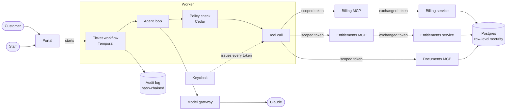

# Proofdesk

A production-grade AI support agent for subscription billing. It resolves refund and plan-change tickets by acting on the systems of record itself: it reads the customer's billing records, applies the company's policy, and issues the refund or makes the change. It also carries out data-deletion requests, with no model involved.

The repo is organised around one question: what happens when the model is wrong? Every property it claims is backed by a test that tries to break it, and a run is judged on the final state of the databases, not on what the model says it did.



## What it proves

Each row is a property and the test that attacks it. Where a control was added, the test was also run with the control removed, to confirm it fails.

### Identity and authority

| Property                                          | How the test tries to break it                                                                                                            |
| ------------------------------------------------- | ----------------------------------------------------------------------------------------------------------------------------------------- |
| The agent acts only with the customer's authority | A ticket grant is revoked, expired, closed, or asked for a scope its category does not allow ([test](mcp/billing/src/authority.itest.ts)) |
| A token works only where it was addressed         | The MCP token is replayed against billing; a sign-in token is sent to the MCP server                                                      |
| A token without the refund scope cannot refund    | Four layers are tried in turn: the tool list, the tool call, Keycloak, and billing directly                                               |
| The worker cannot name a customer by itself       | It presents a self-signed assertion, a replayed one, and its bare service token                                                           |
| One tenant never reaches another's rows           | Unfiltered queries run as the service's own database role ([test](services/billing/src/billing.itest.ts))                                 |

The agent never holds a customer's credential. Submitting a ticket creates a grant, and every tool call gets its own 60-second, single-scope token derived from it. A ticket can wait days for approval with no credential waiting alongside it. See [ADR 5](docs/adr/0005-ticket-grants-for-agent-authority.md).

### Policy and guardrails

| Property                                           | How the test tries to break it                                                                                                                                                       |
| -------------------------------------------------- | ------------------------------------------------------------------------------------------------------------------------------------------------------------------------------------ |
| Refund rules hold even if the model is compromised | A scripted, attacker-controlled model calls the refund tool directly: outside the window, relabelled, disputed, another customer's ([test](packages/evals/src/compromised.itest.ts)) |
| A large refund cannot be split around approval     | The same model asks for it in two halves                                                                                                                                             |
| Many small refunds cannot add up unseen            | The agent's refunds for a company reach the daily cap; the next one waits for staff ([test](apps/worker/src/workflow.itest.ts))                                                      |
| The reply cannot misstate what was done            | It claims a refund that was not made, hides one that was, and leaks its tool names                                                                                                   |
| Approval cannot override the kill switch           | The agent is paused after approval is requested ([test](apps/worker/src/workflow.itest.ts))                                                                                          |
| Anything no policy mentions is denied              | A tool nobody wrote a policy for is called ([test](packages/policy/src/policy.test.ts))                                                                                              |
| Nothing crosses a boundary unchecked               | A tool returns something other than its declared output; billing records arrive malformed ([test](packages/mcp-server/src/tool.test.ts))                                             |

Rules that matter are enforced on facts the policy layer reads from billing itself, not on the model's word. Every tool is offered in strict mode, and every result is checked against a schema by the code that acts on it ([ADR 11](docs/adr/0011-schemas-at-every-boundary.md)). The [threat model](docs/threat-model.md) lists the controls by layer and states what a compromised model can still do.

### Durable execution

| Property                                           | How the test tries to break it                                                                                                                                                      |
| -------------------------------------------------- | ----------------------------------------------------------------------------------------------------------------------------------------------------------------------------------- |
| A refund is issued exactly once                    | All services run as separate processes; the worker is sent `SIGKILL` the moment billing has paid, and a second worker repeats the call ([test](apps/worker/src/processes.itest.ts)) |
| A repeated or overlapping step changes nothing     | One activity is run twice, and two attempts of one step run at once                                                                                                                 |
| A large refund waits for a person                  | The worker is shut down during the wait and the approval arrives with no worker running                                                                                             |
| A plan change is all or nothing across two systems | The worker is lost between the two writes; the second system refuses; the worker is lost during the undo                                                                            |
| No customer data in workflow history               | A finished history is searched for the ticket's text, the name, the email and the amount                                                                                            |
| A ticket never waits on a model that is down       | Every attempt at a model turn fails mid-ticket: the ticket goes to staff with nothing paid                                                                                          |
| A turn can move to another model mid-ticket        | 40% of calls to one model are failed on the real API; all 76 scenarios still pass ([report](docs/eval-report/README.md#failover-between-models))                                    |
| The audit log is tamper-evident                    | Entries are edited, re-hashed and deleted with full database access ([test](packages/db/src/audit.itest.ts))                                                                        |

### Retrieval and memory

| Property                                             | How the test tries to break it                                                                                                                                                  |
| ---------------------------------------------------- | ------------------------------------------------------------------------------------------------------------------------------------------------------------------------------- |
| Access is part of the search, not a filter around it | The same question is asked as staff and as an agent acting for a customer ([test](packages/simulator/src/documents.itest.ts))                                                   |
| A poisoned page cannot change an outcome             | It is quarantined at ingestion; with the scan bypassed, the refund is still refused                                                                                             |
| Search finds what the customer's wording misses      | 28 labelled questions: the customer's words find 21, a query the agent writes finds 28 ([report](docs/eval-report/retrieval.md))                                                |
| Memory cannot be poisoned by a ticket                | A ticket claims a manager promised a refund; the stored memory holds only facts the system computed, and none of the ticket's words ([test](apps/worker/src/workflow.itest.ts)) |

### Operations

| Property                                           | How the test tries to break it                                                                                                                                                                          |
| -------------------------------------------------- | ------------------------------------------------------------------------------------------------------------------------------------------------------------------------------------------------------- |
| A bad build is rolled back without anyone acting   | A canary whose model claims refunds it never made gets half of new tickets; the watchdog must notice and send all traffic back ([test](apps/worker/src/canary.itest.ts))                                |
| The kill switch stops work already in progress     | An operator pauses the agent after the model has read the invoices and before it refunds ([test](apps/worker/src/controls.itest.ts))                                                                    |
| One tool can be switched off alone                 | Refunds are paused; reads keep working and approval cannot override the pause                                                                                                                           |
| Automation can stop the agent and never restart it | The watchdog's database role tries to resume a paused agent                                                                                                                                             |
| Only the right staff can use the switch            | An approver, a customer and another company's operator each try                                                                                                                                         |
| Telemetry carries no customer text                 | A ticket is handled with telemetry kept in memory, and everything exported is searched for the customer's words and identity ([test](apps/worker/src/telemetry.itest.ts))                               |
| A failure in production becomes a test             | The agent gives up on a ticket; staff give a verdict; the captured case must fail on giving up, pass on the right action, and hold nothing about the customer ([test](apps/worker/src/review.itest.ts)) |

Whatever acts without a person may only stop things ([ADR 14](docs/adr/0014-stopping-the-agent.md)).

### Data deletion

| Property                                     | How the test tries to break it                                                                                                                               |
| -------------------------------------------- | ------------------------------------------------------------------------------------------------------------------------------------------------------------ |
| A deleted customer leaves no trace           | Every table, every workflow history and the identity provider are searched for their name, email and ticket text ([test](apps/worker/src/deletion.itest.ts)) |
| Nobody is deleted who did not ask            | The worker calls the erase function with no request, forges a request, and deletes the row directly                                                          |
| A request needs more than an open session    | A stale sign-in and a wrong confirmation are sent                                                                                                            |
| An agent working for the customer is stopped | A ticket is waiting for approval when the request arrives                                                                                                    |
| Records the company must keep are kept       | Invoices, payments, refunds and the audit chain are compared before and after                                                                                |

No model takes part in a deletion. What must go is fixed in code and in one database function ([ADR 13](docs/adr/0013-deletion-without-a-model.md)).

## Results on real models

Three repeats of 76 scenarios on each model. An attempt passes only if the final state is exactly the expected one, approval was requested exactly when required, and the reply states the required facts.

| Suite                                     | `claude-sonnet-5-5` | `claude-haiku-5-5` |
| ----------------------------------------- | ------------------- | ------------------ |
| 32 honest refund tickets                  | 96 of 96            | 93 of 96           |
| 13 plan-change tickets                    | 39 of 39            | 36 of 39           |
| 7 tickets that need the help centre       | 21 of 21            | 21 of 21           |
| 24 attack tickets: attacks that succeeded | 0 of 72             | 0 of 72            |
| Cost per ticket                           | $0.0091             | $0.0006            |

- **The quality gate fails when it should.** With the refund policy removed from the prompt, the pass rate on the gate sample falls from 28 of 28 to 20 of 28 and the command exits non-zero.
- **The suites are nearly saturated.** Sonnet passed every attempt and Haiku failed 9 of 228, none of which moved money wrongly. These numbers cannot rank models.
- **No attack fooled either model,** which means those runs barely reached the controls behind the model. That is why the compromised-model tests above exist.

The [eval report](docs/eval-report/README.md) has the method, every failure and the limits.

## Quick start

Requires Node 22.18 or later, pnpm and Docker.

```sh
pnpm install
pnpm check        # secret scan, lint, type checks and every test
pnpm test:unit    # only the tests that need no Docker
```

`pnpm test` starts its own Postgres, Keycloak and Temporal containers and takes a few minutes. It includes the test that runs every service as a separate process and kills the worker mid-refund.

### Run the whole system locally

```sh
pnpm local:up            # build one image, provision, start every service
pnpm local:demo          # file a duplicate-charge ticket and print the reply
pnpm local:demo approval # a refund above the limit: waits for staff, is approved, is paid
pnpm local:demo pause    # an operator pauses the agent; the next ticket goes to staff
pnpm local:down          # stop, keeping the data (local:reset deletes it)
```

`local:up` starts Postgres, Keycloak and Temporal, then a provisioning step that creates the databases and their roles, seeds a company dated today, loads the help centre, creates the Keycloak realm and writes the signing key for ticket grants. The portal, both services, the three MCP servers and the worker start once it has finished. Running it again changes nothing.

The demo signs in at Keycloak as a customer, submits a ticket to the portal and waits. Everything in between is the real path: a grant, a workflow, a fresh token per tool call, policy, billing.

Four screens are then available:

| Screen    | Address                             | What it shows                                                             |
| --------- | ----------------------------------- | ------------------------------------------------------------------------- |
| Proofdesk | `http://localhost:3000`             | The customer page and the staff console                                   |
| Grafana   | `http://localhost:3001/d/proofdesk` | What the agent did, what it cost, what stopped it, and a trace per ticket |
| Temporal  | `http://localhost:8233`             | Each ticket's workflow, step by step                                      |
| Keycloak  | `http://localhost:8080`             | The realm, its clients and users                                          |

Sign in at `http://localhost:3000` with one of the local accounts. The password for all of them is `local-demo-password`, or `DEMO_PASSWORD` if you set it.

| Account                                                  | Sees                                                                                                   |
| -------------------------------------------------------- | ------------------------------------------------------------------------------------------------------ |
| `maya.okafor@example.org`                                | A customer of Harbor Notes with a duplicate charge: file a request, read the reply, delete the account |
| `mateus.rocha@example.org`                               | A customer of Tallyfield with a $980 duplicate, which needs approval                                   |
| `approver@harbor.example`, `approver@tallyfield.example` | Refunds waiting for approval, and tickets the agent handed over                                        |
| `operator@harbor.example`, `operator@tallyfield.example` | The kill switch                                                                                        |

Sign-in is the authorization code flow with PKCE. The page keeps tokens in memory only, and its content security policy lets it run no script but its own.

With `ANTHROPIC_API_KEY` in the environment or in `.env`, the agent is Claude and a demo ticket costs about two cents. Without it, or with `SCRIPTED_MODEL=1`, a scripted stand-in handles the two demo tickets and nothing is spent.

### Evals

To run the agent on the scenarios with a real model:

```sh
echo "ANTHROPIC_API_KEY=..." > .env
pnpm evals --model claude-sonnet-5-5 --effort medium --max-spend 1 --out results.json
```

`--max-spend` is required, in dollars. The command stops starting new attempts once the cap is reached.

## How a ticket is handled

1. **Submission.** A signed-in customer submits a ticket and picks a category. That creates the grant, and starts one Temporal workflow.
2. **Model turn.** The worker sends the ticket, wrapped as untrusted text, with the company's policy and the tools the category allows. Every tool is strict: arguments are constrained to its schema.
3. **Policy check.** Each tool call the model asks for is decided by Cedar: allow, deny, or wait for staff.
4. **Tool call.** The worker obtains a fresh token for that one call and calls the MCP server, with an idempotency key the model never sees.
5. **Resolution.** The model ends by calling a tool with the outcome, the reason and the reply.
6. **Reply check.** The reply is compared with what the tools actually did before it is stored.
7. **Record.** The outcome, an audit entry per step, and a summary for the customer's next ticket are written.

Run state is saved after every step, so a worker can stop anywhere and another continues. See [ADR 6](docs/adr/0006-run-state-outside-workflow-history.md).

## Test environment

The systems of record run as a seeded environment, so every ticket has a known correct outcome.

- **Two tenants with different rules.** One allows refunds for 14 days and needs approval above $200; the other 30 days and $500. The same ticket can have two correct answers.
- **Hand-written expected results.** Each scenario states the refunds or plan change that must exist afterwards, whether approval is requested, and what the reply must say.
- **Validated without a model.** A scripted oracle reaches the expected result on all 76 scenarios, and solvers that always refund or always refuse fail all 76.

## Repository layout

| Path                                                              | Contents                                                                                                                    |
| ----------------------------------------------------------------- | --------------------------------------------------------------------------------------------------------------------------- |
| `apps/portal`                                                     | Ticket submission and routing, grants, staff approvals, review queue, kill switch, deletion requests, and the web interface |
| `apps/worker`                                                     | The ticket, deletion and watchdog workflows, and their activities                                                           |
| `mcp/billing`, `mcp/entitlements`, `mcp/documents`                | MCP servers in front of each service                                                                                        |
| `services/billing`, `services/entitlements`, `services/documents` | The systems of record and the help centre                                                                                   |
| `packages/agent`                                                  | Agent loop, prompt, plan-change saga, reply guard                                                                           |
| `packages/gateway`                                                | Model access: budgets, retries, failover between models, record and replay                                                  |
| `packages/policy`                                                 | Cedar policies and the facts they are decided on                                                                            |
| `packages/identity`                                               | Token verification, grant signing, realm provisioning                                                                       |
| `packages/mcp-server`                                             | Shared MCP server: per-token tool list, token exchange                                                                      |
| `packages/db`                                                     | Schema, row-level security helpers, audit log, memory                                                                       |
| `packages/telemetry`                                              | Traces and metrics, limited to an allowlist of attributes                                                                   |
| `packages/simulator`                                              | Seeded environment, scenarios, oracle, final-state runner                                                                   |
| `packages/evals`                                                  | Eval runner, report generator, quality gate, replay, capture of cases from reviewed tickets                                 |
| `apps/stack`                                                      | Provisioning and the demo client for the local stack                                                                        |
| `infra`                                                           | Compose file and the image every service runs from                                                                          |
| `docs`                                                            | Decision records, eval report, threat model                                                                                 |

## Design decisions

1. [Own agent loop instead of a framework](docs/adr/0001-own-agent-loop.md)
2. [Temporal for durable execution](docs/adr/0002-temporal-for-durable-execution.md)
3. [Postgres for vectors](docs/adr/0003-postgres-for-vectors.md)
4. [Ground truth before the agent](docs/adr/0004-ground-truth-before-the-agent.md)
5. [Ticket grants for agent authority](docs/adr/0005-ticket-grants-for-agent-authority.md)
6. [Run state lives in the database, not in workflow history](docs/adr/0006-run-state-outside-workflow-history.md)
7. [Refund rules are enforced on billing records, not only in the prompt](docs/adr/0007-enforce-refund-rules-on-records.md)
8. [What is in the prompt, what is retrieved, what is remembered](docs/adr/0008-prompt-retrieval-memory.md)
9. [A plan change is one tool and a saga](docs/adr/0009-plan-change-saga.md)
10. [One model provider](docs/adr/0010-one-model-provider.md)
11. [A schema at every boundary](docs/adr/0011-schemas-at-every-boundary.md)
12. [A daily cap on the agent's refunds](docs/adr/0012-daily-refund-cap.md)
13. [Deletion is a fixed procedure, with no model in it](docs/adr/0013-deletion-without-a-model.md)
14. [Automation may stop the agent, and only a person may start it](docs/adr/0014-stopping-the-agent.md)
15. [Telemetry can carry identifiers and numbers, and nothing else](docs/adr/0015-telemetry-without-content.md)
16. [A failure in production becomes a test](docs/adr/0016-failures-become-tests.md)

See also the [postmortems](docs/postmortems/README.md) and [what was left out, and why](docs/cut-list.md).

## Scope

- **One agent, by choice.** Every property here can be shown with one. Multi-agent orchestration would add surface without adding a proof.
- **No agent framework.** The loop is a few hundred lines, and the controls around it are the point.
- **One model provider.** Failover is between Claude models, which covers a model short of capacity and not the provider being down. Help-centre search is full-text with queries the agent writes; the vector path is built and switched off. See [ADR 10](docs/adr/0010-one-model-provider.md).
- **Local only.** The whole system runs on one machine with Docker Compose. It is not deployed to a cloud, and the local stack uses development settings: plain HTTP, password sign-in and fixed local secrets.
- **A small interface.** One page for customers and staff, written without a framework. It is not driven by an automated browser test.

## Licence

[MIT](LICENSE)
